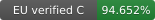
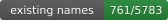
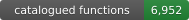
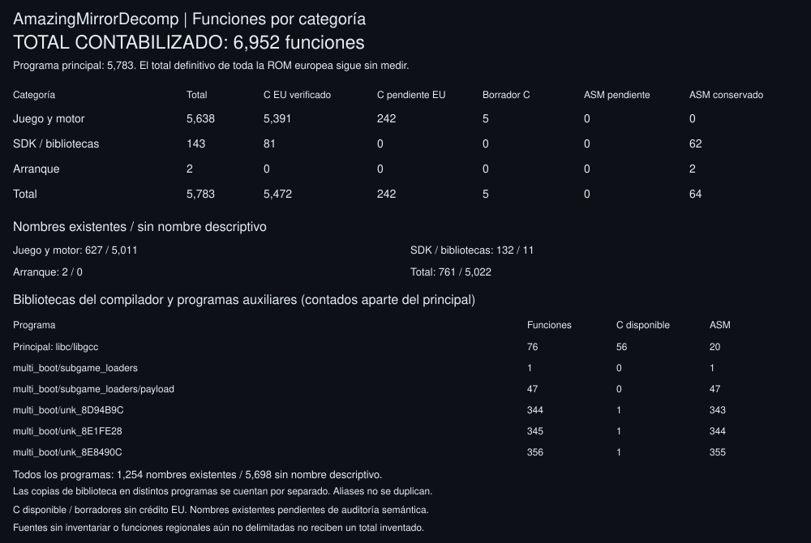
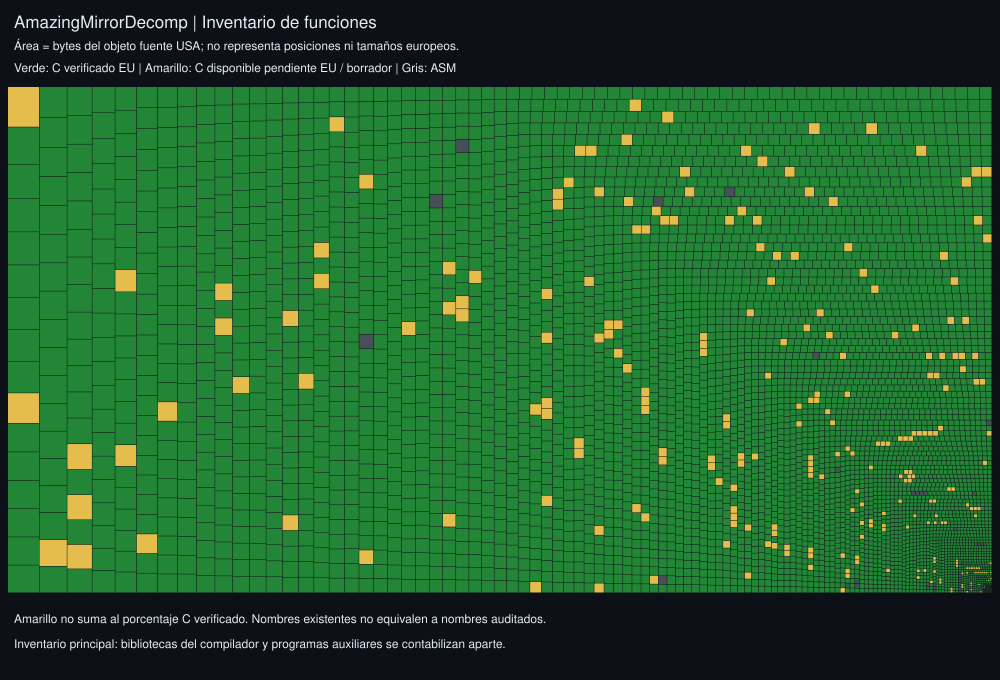
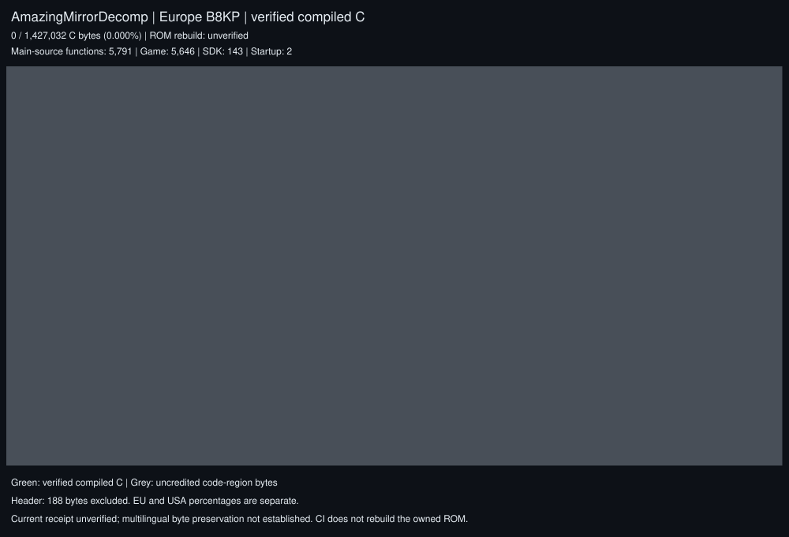
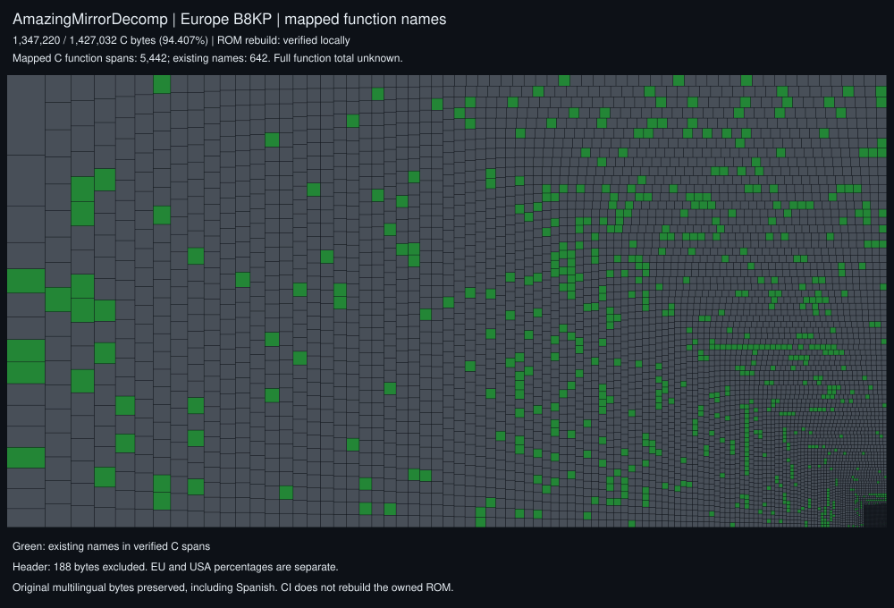
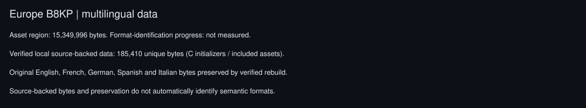

# AmazingMirrorDecomp

European multilingual decompilation and matching rebuild of Kirby & The Amazing Mirror (B8KP), including the original Spanish option.

This repository is MatyMeatBoy's AmazingMirrorDecomp research and progress base, preserving the original katam history. See [credits](CREDITS.md), [public-source research](docs/research/), and [local reuse findings](docs/research/LOCAL_REUSE.md). Candidate contributions are recorded with their provenance and validation status; being listed does not mean they have been merged or verified.

## Progress

   







Each cell is one inventoried source function. Green means verified European C; yellow means existing C awaiting European verification or a readable C draft; grey means pending or intentionally retained assembly. Cell areas use source-object sizes, not European positions or regional sizes. Yellow receives no verified C credit. See the [full function inventory](docs/progress/functions.json) and [category/name tables](docs/progress/progress.md).

The visible total also includes separately compiled functions from linker-selected libc/libgcc members and five auxiliary programs. Library copies in different programs count separately; aliases do not. These additional objects have no European matching credit. The [recovered terrain draft](docs/research/drafts/README.md) and existing alternate C bodies are compiled before receiving yellow draft status; stale or failed drafts return to pending ASM.

<details>
<summary>European byte coverage and exact ROM evidence</summary>



</details>

<details>
<summary>Existing function names</summary>



</details>

<details>
<summary>Data recovery</summary>



</details>

The [European report](docs/progress/progress.md) counts only source-compiled C spans verified against the owned EU ROM. Every rebuilt byte, including pending raw code and multilingual data, must match that original. The executable boundary is independently established at `0x15C714`; the 188-byte cartridge header is excluded. Pending raw code earns no C credit. Verified source-backed local data is reported separately and deduplicated by physical range; it includes C initializers and asset inclusions and does not establish semantic format recovery. The main-source function total is partitioned into game/engine, SDK/libraries and startup. Compiler archives and auxiliary multiboot programs are counted in separate rows; the complete European ROM function count and data-format recovery percentage are not measured.

Existing names in verified C spans are shown separately and do not establish semantic correctness. Address-derived source identifiers retain the original project's names; actual European addresses come from the regional span/binding evidence. Source assets, naming proposals and readable drafts do not automatically increase matching C coverage.

<details>
<summary>USA reference and reusable research</summary>

The [USA source inventory](docs/progress/usa/progress.md) measures unlinked main-object text, excluding compiler archives and auxiliary targets. It is a separate reference, not a European percentage or a newly verified USA ROM.

See the [fork and port audit](docs/research/REPOSITORY_AUDIT.md), [European fork search](docs/research/EU_FORK_SEARCH.md), [other forge searches](docs/research/EXTERNAL_FORGES.md), [naming and drafts](docs/research/NAMING_AND_DRAFTS.md), [data recovery audit](docs/research/DATA_RECOVERY.md), and [pending integration evidence](docs/research/INTEGRATION_STATUS.json).

[Preserved research branches](docs/research/PRESERVED_DRAFTS.md) retain the complete historical naming proposal and readable collision draft. [European integration results](docs/research/EU_RECOVERY_PROGRESS.md) record the separately verified source gains.

[Remaining-source search](docs/research/REMAINING_SOURCE_SEARCH.md) crosses the current European gaps with a refreshed fork inventory and additional tools, randomizers and recompilations.

</details>

With the matching toolchain installed, supply your own EU dump as `baserom_eu.gba` and run:

```sh
make compare
make record-eu
make progress-map
python -m unittest discover -s tests
```

`make` and `make progress` also use Europe. Pass `EU_ROM=/path/to/owned.gba` for another local path. `record-eu` records only compact source fingerprints and verification metadata after a successful rebuild. `progress-map` and the [progress workflow](.github/workflows/progress.yml) regenerate reports without acquiring a ROM; they validate the recorded local receipt against all current source inputs. Missing or changed evidence clears European C credit. Publication starts from fresh `main`, restricts commits to `docs/progress/`, and retries a concurrent branch advance. No ROM, extracted assets, objects or private paths are published.

The original USA Makefile remains available through `make REGION=us compare` with an owned USA `baserom.gba`. Its six expected checksum checks are `katam.gba`, `payload.gba`, `speed_eaters.gba`, `unk_8D94B9C.gba`, `unk_8E1FE28.gba`, and `unk_8E8490C.gba`. A European rebuild does not verify those USA outputs or a complete `NONMATCHING` build. The EU pipeline preserves embedded auxiliary images without claiming independent auxiliary C recovery.

## European target

16 MiB, game code **B8KP**, revision 0, SHA1 **`6f478a455383a2a12378f292581dfd7300300700`**. The original selectable languages are English, French, German, Spanish and Italian. Spanish is the original language ID 4; use the game's language selector. The build preserves all original choices.

See [regional evidence and setup](docs/REGIONS.md). The original [installation guide](INSTALL.md) describes the compiler and USA source base; use the European commands above for our default profile.

## Original USA reference target

* [**katam.gba**](https://datomatic.no-intro.org/index.php?page=show_record&s=23&n=1692) `sha1: 274b102b6d940f46861a92b4e65f89a51815c12c`

## Contacts

You can find us on [Discord](https://discord.gg/d5dubZ3).
